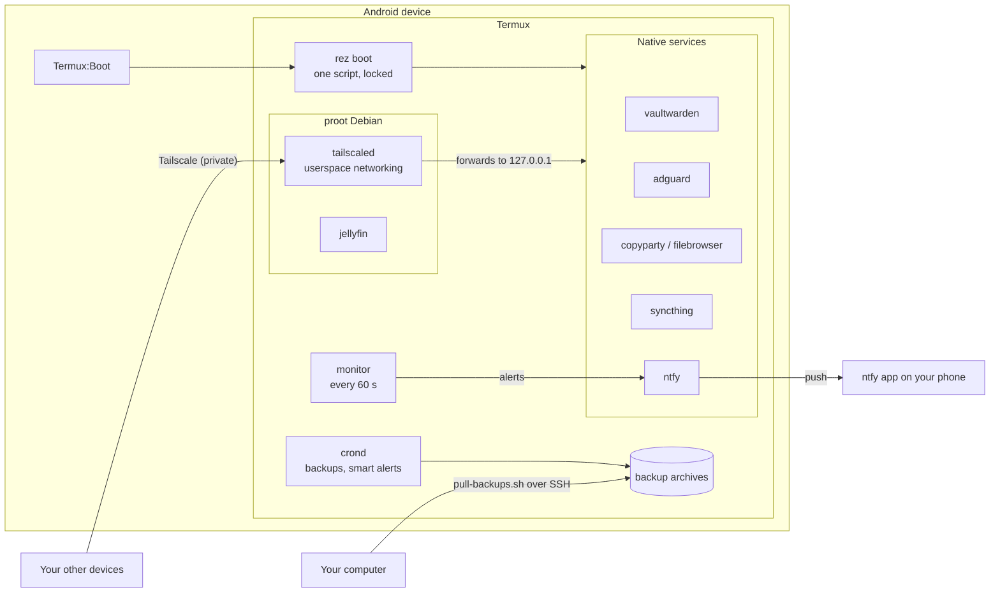

<div align="center">

# resurrect

**Raise your dead phone as a homelab.**

[](https://github.com/JathinYanna04/Resurrect/actions/workflows/ci.yml)
[](LICENSE)
[](https://github.com/JathinYanna04/Resurrect/releases)
[](#requirements)

</div>

<!--
  Demo: add a short recording of `rez setup` here, for example:
  <p align="center"></p>
-->

resurrect turns an old Android phone or tablet (the *device* throughout these docs) into a small, private, self-hosted server using [Termux](https://termux.dev). One command sets up a password manager, ad blocking, file sharing, folder sync, push notifications, backups and LLM-filtered alerts. You reach them from anywhere over Tailscale, and nothing is exposed to the internet. Root is not needed.

> [!NOTE]
> resurrect is a **pre-release (0.1)**. It has been tested in the official Termux container, not yet on a range of real devices. [Tested status](#tested-status) lists exactly what has been verified, and a [device report](https://github.com/JathinYanna04/Resurrect/issues/new?template=device-report.yml) from your device helps everyone.

## Contents

- [Why resurrect](#why-resurrect)
- [Features](#features)
- [Requirements](#requirements)
- [Quick start](#quick-start)
- [Profiles](#profiles)
- [Usage](#usage)
- [Architecture](#architecture)
- [Root vs no root](#root-vs-no-root)
- [Security model](#security-model)
- [Tested status](#tested-status)
- [Documentation](#documentation)
- [FAQ](#faq)
- [Contributing](#contributing)
- [License](#license)
- [Disclaimer](#disclaimer)

## Why resurrect

Most people have an old phone in a drawer. It is a capable 64-bit ARM computer with Wi-Fi, several gigabytes of RAM and a built-in battery that works as a UPS, and it draws a few watts. resurrect makes it useful again as an always-on home server, without root and without replacing Android. It handles the parts that make phones hard to run as servers, such as background process limits, startup at boot, PID reuse and DNS outages, so that services come back by themselves after a reboot.

## Features

Every module is optional except `base`, and each one supports `install`, `start`, `stop`, `status` and `uninstall`. RAM figures are the estimates that `rez setup` adds up in its plan; they have not yet been measured on a range of devices.

| Module | What it gives you | Root | RAM (est.) |
|---|---|---|---|
| `base` | Termux packages, SSH with key-only login (port 8022), wake lock, cron, the single boot script | No | 10 MB |
| `tailscale` | Private remote access to every service. Runs built in (userspace, inside proot Debian) or through the Android app | No | 40 MB |
| `cloudflared` | Cloudflare Tunnel, for services you deliberately make **public** | No | 30 MB |
| `ntfy` | Push notifications. Every alert from resurrect goes here. Local server or an existing one | No | 25 MB |
| `vaultwarden` | Bitwarden-compatible password manager over HTTPS. Sign-ups close automatically after you create your account | No | 30 MB |
| `adguard` | AdGuard Home ad and tracker blocking. DNS on port 5335 without root, port 53 with root | Optional | 110 MB |
| `copyparty` | File sharing in the browser, WebDAV and uploads | No | 40 MB |
| `filebrowser` | File Browser, an alternative web file manager | No | 30 MB |
| `syncthing` | Continuous folder sync with your other devices | No | 40 MB |
| `backup` | Nightly archive of every module's data, rotation, weekly restore test, alert when copies stop leaving the device | No | none (cron) |
| `monitor` | Health checks every minute with ntfy alerts, one automatic restart and a recovery message | No | 5 MB |
| `alerts` | Smart alerts: an LLM you choose filters feeds, APIs and web pages for what you describe | No | none (cron) |
| `jellyfin` | Jellyfin media server, direct play only. Needs 3.5 GB RAM and an SD card or external storage | No | 350 MB |
| `acc` | Battery charge limit (pause at 80 %, resume at 70 %) | Required | none |

Run `rez modules` to see which modules fit your device and why the others don't.

## Requirements

| | Minimum | Recommended |
|---|---|---|
| Android | 7.0, the oldest version current Termux supports | 10 or newer |
| CPU architecture | arm64, armv7 or x86_64. On 32-bit devices some modules are unavailable (`rez modules` shows which) | arm64 |
| RAM | About 2 GB for the Lite profile | 3-4 GB for Standard, 6 GB or more for Full |
| Free storage | 2 GB in Termux's home folder | 8 GB or more, plus an SD card for media |
| Power | Plugged in permanently | With root, `acc` to limit the charge level |

You also need these apps, **all from [F-Droid](https://f-droid.org) or all from GitHub**, never mixed and never from Google Play:

| App | Needed for |
|---|---|
| [Termux](https://f-droid.org/packages/com.termux/) ([GitHub releases](https://github.com/termux/termux-app/releases)) | Everything |
| [Termux:Boot](https://f-droid.org/packages/com.termux.boot/) | Starting services after a reboot |
| [Termux:API](https://f-droid.org/packages/com.termux.api/) | Optional. Battery temperature readings for `monitor` when the system doesn't expose them directly |

> [!WARNING]
> The Termux build on Google Play is outdated and package installs fail with it. `rez doctor` flags it. Install Termux from F-Droid or GitHub instead.

Remote access uses a free [Tailscale](https://tailscale.com) account by default.

## Quick start

### One-line install

Open Termux on the device and run:

```bash
curl -fsSL https://raw.githubusercontent.com/JathinYanna04/Resurrect/main/install.sh | bash
```

The script checks that it runs inside Termux, updates Termux packages, installs `git`, `curl`, `jq`, `dialog` and `util-linux`, clones resurrect into `~/.resurrect` and starts `rez setup`. Setup asks before it installs anything else. It never needs root, and it never flashes or reboots anything.

### Verify first (recommended)

To read the installer before you run it:

```bash
pkg install -y git
git clone https://github.com/JathinYanna04/Resurrect ~/.resurrect
less ~/.resurrect/install.sh
~/.resurrect/install.sh
```

To see the full plan and every command without changing anything:

```bash
rez --dry-run setup
```

### Non-interactive install

Answer the questions with flags or with an answers file (see [`config/resurrect.conf.example`](config/resurrect.conf.example)):

```bash
~/.resurrect/install.sh --profile lite --modules vaultwarden,ntfy --yes
rez --yes setup --config my-answers.conf
```

`--modules` installs exactly those modules plus their dependencies. `--profile` on its own installs the profile's modules.

### After setup

1. Open **Termux:Boot** once. Android only lets it run at boot after it has been opened.
2. Set Termux's battery usage to **Unrestricted** (Settings > Apps > Termux > Battery).
3. On Android 12 or newer, turn off the phantom process killer. `rez doctor` prints the commands.
4. Reboot, then run `rez status`. Everything should have come back by itself.

## Profiles

Setup recommends a profile from the RAM the device reports (MemTotal). Devices report less than their advertised size, so a "3 GB" device shows about 2.8 GB; the thresholds account for that. You can add or remove modules before anything is installed.

| Profile | MemTotal | Typical device | Modules | RAM (est.) |
|---|---|---|---|---|
| **Lite** | under 2600 MB | 2 GB | `base`, `tailscale`, `ntfy`, `vaultwarden`, `backup`, `monitor` | ~110 MB |
| **Standard** | 2600-5199 MB | 3-4 GB | Lite + `adguard`, `copyparty`, `syncthing`, `alerts` | ~300 MB |
| **Full** | 5200 MB or more | 6 GB or more | Standard + `jellyfin` (needs an SD card or external storage) | ~650 MB |

`cloudflared`, `filebrowser` and `acc` are in no profile; pick them in the setup checklist (where `acc` is pre-selected when root is available) or add them later with `rez install`.

## Usage

```bash
rez status                      # every installed module, MemAvailable and free storage
rez doctor                      # check the reliability rules and explain problems
rez start [module...]           # start modules (default: all installed)
rez stop [module...]            # stop modules (default: all installed)
rez restart [module...]         # stop, then start
rez logs [module]               # follow a module's log (no argument: rez's own log)
rez install <module>...         # add modules (and their dependencies)
rez uninstall <module>... [--purge]  # remove modules; --purge also deletes their data
rez modules                     # list modules and whether they fit this device
rez device [--report]           # hardware, ROM, root and custom ROM options (read-only)
rez backup run|list|verify|extract
rez health                      # run every health check once and print a table
rez help                        # all commands and global options
```

Modules add their own commands, for example:

```bash
rez tailscale up                # log in to your tailnet
rez ntfy test                   # send a test notification
rez vaultwarden show-admin-password
rez adguard test                # check that AdGuard answers DNS
rez alerts run job-postings --dry-run
```

Global options work with every command: `--dry-run` prints what would happen and changes nothing, `--yes` accepts the plan without prompts, `--non-interactive` fails instead of asking, and `--debug` prints more detail.

## Architecture

Termux:Boot starts one script at boot. That script holds a lock and starts each installed module only if it is not already running. Most services run natively in Termux; `tailscaled` and Jellyfin run inside a Debian userland provided by proot, which needs no root.



With the Tailscale app instead of the built-in mode, the app handles the tailnet connection and services listen on all interfaces. Details: [docs/remote-access.md](docs/remote-access.md).

## Root vs no root

Everything works without root. Root only adds two optional features, and setting it up is a manual process that resurrect never automates.

| | No root | Root |
|---|---|---|
| All modules except `acc` | Yes | Yes |
| AdGuard Home DNS port | 5335. Computers use a small local forwarder ([guide](docs/dns-and-adguard.md)) | 53, so any device can use it directly |
| AdGuard Home started by | resurrect's boot script, under a supervisor | Magisk at every boot, independent of Termux |
| Battery charge limit | Not available | `acc` pauses charging at 80 % and resumes at 70 % |
| Setup | Fully automatic | Rooting is a manual, guided process: [docs/rooting.md](docs/rooting.md) |

## Security model

- **Private by default.** Remote access goes through Tailscale. With the built-in mode, services listen on `127.0.0.1`, so they're reachable over your tailnet but not from the Wi-Fi network.
- **Nothing is public** unless you install `cloudflared` and publish a service yourself.
- **Logins everywhere.** SSH accepts keys only. AdGuard Home, copyparty, File Browser and Syncthing get an admin login with a generated password, ntfy denies anonymous access, and Vaultwarden closes sign-ups once your account exists. Jellyfin uses its own first-run wizard, so finish it right after installing.
- **Secrets stay in files.** Each secret is one file in `~/.config/resurrect/secrets/` (folder mode 700, files mode 600). Secrets never go in the config file or the logs, or on the command line of a running service.
- **Verified downloads.** Every binary is pinned to a version and checked against a SHA-256 checksum. A mismatch aborts the install.

Read [docs/security.md](docs/security.md) for the exceptions and what is left to you, and [SECURITY.md](SECURITY.md) to report a vulnerability.

## Tested status

| Area | Status |
|---|---|
| Unit tests: 78 bats tests, 25 Python tests | Pass on Linux and inside the official Termux Docker image |
| Real install in Termux (x86_64 container), 43 behaviour checks | Pass: `base`, `ntfy`, `vaultwarden`, `adguard` (no root), `copyparty`, `filebrowser`, `syncthing`, `backup`, `monitor`, `alerts`, boot lock, stale pidfiles |
| `tailscale`, `cloudflared`, `jellyfin`, `acc`, AdGuard root mode | **Not tested yet** (dry run only). They need a real device, an account or root |
| Termux:Boot, phantom process killer, Doze, arm64 binaries, proot on an Android kernel | **Not tested yet**. A container can't show Android behaviour |

The full breakdown is in [docs/testing.md](docs/testing.md). Devices that have been reported are listed in [docs/tested-devices.md](docs/tested-devices.md).

**Run resurrect on a device? Please send a report.** Run `rez device --report` (it contains no serial numbers or addresses) and paste the output into a [device report](https://github.com/JathinYanna04/Resurrect/issues/new?template=device-report.yml).

## Documentation

| Guide | What it covers |
|---|---|
| [Troubleshooting](docs/troubleshooting.md) | Fixes organized by symptom |
| [DNS and AdGuard Home](docs/dns-and-adguard.md) | Safe DNS setup, an outage case study, emergency switch-off |
| [Remote access](docs/remote-access.md) | Tailscale modes, HTTPS certificates, Cloudflare Tunnel |
| [Security](docs/security.md) | Defaults, exceptions, hardening steps |
| [Backups and restore](docs/backups.md) | What is backed up, restore tests, restoring to a new device |
| [Computer-side extras](extras/laptop/README.md) | Pulling backups to a computer, DNS with automatic fallback |
| [Custom ROMs](docs/custom-rom.md) | Optional and manual: finding and installing a maintained ROM |
| [Rooting](docs/rooting.md) | Optional and manual: Magisk, and what root unlocks |
| [Writing a module](docs/writing-a-module.md) | The module contract and a complete example |
| [Testing](docs/testing.md) | Running the tests and what is tested where |
| [Tested devices](docs/tested-devices.md) | Device reports from users |
| [Changelog](CHANGELOG.md) | Changes in each release |

## FAQ

**Is an old phone or tablet really good enough?**
For a household's passwords, notifications, ad blocking and files, yes. A device from the last several years has more CPU than most single-board computers, and its battery rides out power cuts. Video transcoding is where it falls short, which is why Jellyfin is set up for direct play only.

**Does it have to stay plugged in?**
Yes. With root, `acc` keeps the battery between 70 % and 80 %, which is much easier on it than sitting at 100 %. Without root, check the battery for swelling from time to time.

**Why Tailscale instead of opening ports?**
Your services stay invisible to the internet, it works on mobile data and behind carrier NAT, and there is no router to configure. Cloudflare Tunnel is available for the few things you want public.

**Why do some services run in proot Debian?**
`tailscaled` and Jellyfin expect a normal Linux filesystem (`/etc`, `/var/lib`). proot provides one without root. Everything that runs natively in Termux does.

**How do I update?**
Run `git -C ~/.resurrect pull`, then `rez install <module>` for each module whose pinned version changed (see the [changelog](CHANGELOG.md)). `pkg upgrade` updates Termux packages.

**How do I remove everything?**
Run `rez uninstall <module> --purge` for each module (finish with `base`, which also removes the boot script, the `rez` command and the cron block). Then delete `~/.resurrect`, `~/.config/resurrect`, `~/.local/share/resurrect` and `~/.local/state/resurrect`. Backups in `~/resurrect-backups` are left in place on purpose.

## Contributing

Device reports, bug reports, fixes and new modules are welcome. Read [CONTRIBUTING.md](CONTRIBUTING.md) to get started, and follow the [Code of Conduct](CODE_OF_CONDUCT.md).

## License

resurrect is released under the [MIT License](LICENSE).

## Disclaimer

resurrect is provided as is, without warranty of any kind. You are responsible for your device, your data and anything you expose to a network.

Unlocking a bootloader, rooting and installing a custom ROM can **erase all data, void your warranty and permanently brick a device**. resurrect never does any of these for you; it only explains the options and links to official guides. A device that stays plugged in all the time carries a small risk of battery swelling, so check it now and then.

resurrect is not affiliated with Termux, Tailscale, Bitwarden, Vaultwarden, AdGuard, Cloudflare, Jellyfin, Syncthing, copyparty, File Browser, ntfy, Magisk, ACC or LineageOS.
