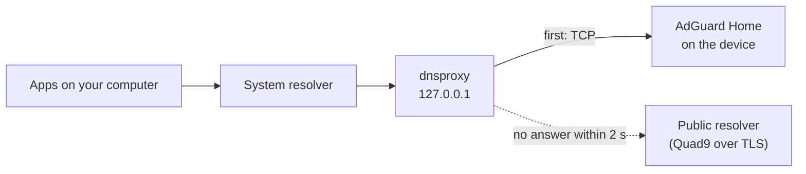

# DNS and AdGuard Home

This guide explains how to run AdGuard Home on your device without putting your other devices' internet connection at risk. It covers how resurrect configures AdGuard Home, how to point clients at it safely, a real outage that shaped these rules, and the steps to switch everything off in an emergency. Read it before you point any device at the `adguard` module.

## Contents

- [The one rule](#the-one-rule)
- [Prerequisites](#prerequisites)
- [How resurrect configures AdGuard Home](#how-resurrect-configures-adguard-home)
- [Set up AdGuard Home](#set-up-adguard-home)
- [Point clients at it safely](#point-clients-at-it-safely)
- [Case study: a tailnet-wide DNS outage](#case-study-a-tailnet-wide-dns-outage)
- [Emergency: names stop resolving](#emergency-names-stop-resolving)
- [Troubleshooting](#troubleshooting)

## The one rule

> [!CAUTION]
> **Never make the device the only DNS resolver for your other devices.** Devices reboot, crash, run out of battery and drop off Wi-Fi. When that happens, every device that depends on it for DNS loses the internet: web pages, apps, and sometimes the tools you would use to fix it.

resurrect never changes DNS settings on your other devices, and setup repeats this warning when you install `adguard`. Always give clients a fallback, as described in [Point clients at it safely](#point-clients-at-it-safely).

## Prerequisites

- resurrect installed with the `base` module. `tailscale` is recommended so your computers can reach the device from anywhere.
- About 110 MB of free RAM (more with large blocklists; 100,000 rules use roughly 25 MB).
- For root mode only: a rooted device with Magisk. See [rooting.md](rooting.md).

## How resurrect configures AdGuard Home

### Root and no root

Android doesn't let apps listen on ports below 1024, so without root the DNS server can't use port 53.

| | No root (`adguard.mode=noroot`) | Root (`adguard.mode=root`) |
|---|---|---|
| DNS port | 5335 (`adguard.dns_port`) | 53 |
| Started by | resurrect's boot script, under a supervisor | Magisk at every boot, through `/data/adb/service.d/resurrect-adguard.sh`, even if Termux is broken |
| Files | `~/.local/share/resurrect/adguard/` | `/data/adb/resurrect/adguard/` |
| Clients | Need a forwarder that can use a custom port, such as the computer setup below | Any device can use it directly (with the rule above in mind) |

Setup offers root mode only when root is available and you have granted it.

### First-time configuration

AdGuard Home's setup wizard refuses to start unless it can bind privileged ports, which an app without root never can. resurrect therefore writes the initial configuration itself:

| Setting | Value |
|---|---|
| Admin interface | Port 3000 (`adguard.ui_port`), user `admin`, generated password (`rez adguard show-password`) |
| DNS | Port 5335 without root, 53 with root, on all interfaces |
| Upstreams | Quad9 and Cloudflare over DNS-over-HTTPS, load-balanced, with DNSSEC and optimistic caching |
| Bootstrap resolvers | `9.9.9.9` and `1.1.1.1` |
| Blocklist | AdGuard DNS filter |
| Query log and statistics | Kept for 24 hours, which keeps the database small |

After the first start, AdGuard Home owns the file. Change settings in its web interface.

resurrect starts AdGuard Home with `SSL_CERT_FILE` pointing at Termux's CA bundle, with Android's certificate store as a fallback. Without it, AdGuard Home's Linux build finds no certificates on Android and every DNS-over-HTTPS upstream fails with `certificate signed by unknown authority`.

## Set up AdGuard Home

### 1. Install

```bash
rez install adguard
```

### 2. Check that it answers DNS

```bash
rez adguard test
```

Expected output without root:

```text
 ok AdGuard answers DNS on port 5335
```

The `monitor` module runs the same check every minute: a real DNS query over TCP. It alerts after two failures in a row.

### 3. Open the admin interface

Over Tailscale, open `http://<tailscale ip>:3000` and log in as `admin` with the password from `rez adguard show-password`. Use the IP rather than the `.ts.net` name; see [remote-access.md](remote-access.md#opening-services).

> [!TIP]
> For more blocking, add one of the [HaGeZi DNS blocklists](https://github.com/hagezi/dns-blocklists) under **Filters > DNS blocklists**. Bigger lists cost more RAM.

## Point clients at it safely

The safe pattern is a small forwarder on each computer that **asks the device first and falls back to a public resolver automatically**. Most operating systems don't fall back reliably when you list a second DNS server: some query both at once and leak around the blocker, and some keep using the dead one for a while.



Step-by-step setup for Linux, macOS and Windows, and how to prove the fallback works, are in [extras/laptop/README.md](../extras/laptop/README.md#use-adguard-home-without-risking-your-internet).

### Use TCP to reach the device

With built-in (userspace) Tailscale, inbound UDP forwarding has crashed `tailscaled`. The forwarder configuration uses `tcp://`, and resurrect's own health check also uses TCP.

### The device never uses its own AdGuard Home

resurrect starts `tailscaled` with `--accept-dns=false`. A device that resolves names through a service running on itself can't recover when that service is down.

### Phones, tablets and whole networks

Android's Private DNS and iOS DNS profiles have no fallback, so point them at the device only if you accept that they lose DNS when it is down. For a whole network, set the device as the primary DNS server in your router and a public resolver as the secondary, knowing that some ads will get through the secondary.

### Tailscale-wide DNS

You can set the device as a global nameserver in the Tailscale admin console (DNS page). If you do:

- Keep **Override local DNS** off, so devices keep their normal resolver as a fallback. With it on, the device becomes the only resolver for your whole tailnet, which is exactly the setup in the case study below.
- Learn the [emergency steps](#emergency-names-stop-resolving) before you need them.

## Case study: a tailnet-wide DNS outage

This happened on the single-device setup that resurrect grew out of. It is the reason for most of the DNS rules on this page.

### Setup

A rooted device ran AdGuard Home on port 53, started at boot by a root launcher script. The device was set as the global nameserver for the tailnet with **Override local DNS** on, so every device in the tailnet sent all its DNS queries to it.

### Timeline

| Step | What happened | Effect |
|---|---|---|
| 1 | A planned reboot of the device, to test that everything came back by itself | Every device in the tailnet lost DNS |
| 2 | AdGuard Home started again after about a minute | DNS came back |
| 3 | A second planned reboot | Every device lost DNS again |
| 4 | AdGuard Home **did not start at all** | The outage continued with no end in sight |
| 5 | Tailscale was switched off on a laptop, and the global nameserver was removed in the Tailscale admin console | Devices fell back to their normal DNS and recovered |

### Root cause

The trigger was a stale pidfile. The boot script checked "is the PID in my pidfile still alive?" with `kill -0`. After the reboot, Android had given that PID to an unrelated system process. Running as root, `kill -0` succeeded on that process, so the script concluded AdGuard Home was already running and exited without starting it.

The underlying cause was the design: one device was the only DNS resolver for every other device, so a single bug on it took down name resolution for the whole tailnet.

### Lessons now built into resurrect

| Lesson | What resurrect does |
|---|---|
| A pidfile alone proves nothing after a reboot | Every "is it running" check reads `/proc/<pid>/cmdline`. The root-mode launcher only trusts its pidfile when that PID really is AdGuard Home |
| Failures must be noticed in minutes, not by users | `monitor` sends a real DNS query every minute and alerts after two failures |
| No device may depend on a single resolver | The documented client setup always falls back to a public resolver |
| A device must not depend on itself | `tailscaled` runs with `--accept-dns=false` |
| Know the way out before you need it | The emergency steps below |

## Emergency: names stop resolving

Work through these in order. Each step restores DNS for more devices.

1. **Tailscale-wide DNS:** from any device that still works (a phone on mobile data with Tailscale switched off is fine), open the [Tailscale admin console DNS page](https://login.tailscale.com/admin/dns). Turn off **Override local DNS**, or remove the device's address. Devices fall back to their normal DNS within seconds.
2. **One device, right now:** stop it from using tailnet DNS.

   ```bash
   tailscale set --accept-dns=false
   ```

   In the Android or iOS app: **Settings > Use Tailscale DNS** off.
3. **A Linux computer using the forwarder:** remove it.

   ```bash
   sudo bash extras/laptop/dns-fallback/undo-linux.sh
   ```

   On macOS or Windows, set DNS back to automatic.
4. **Then fix AdGuard Home on the device:**

   ```bash
   rez status
   rez logs adguard
   rez adguard test
   ```

   In root mode, the log is at `/data/adb/resurrect/adguard/agh.log`:

   ```bash
   su -c 'tail /data/adb/resurrect/adguard/agh.log'
   ```

## Troubleshooting

| Symptom | Cause | Fix |
|---|---|---|
| `no DNS answer on port 5335` | AdGuard Home is not running or still starting | Run `rez status` and `rez logs adguard`, then `rez start adguard` |
| `certificate signed by unknown authority` in the log | Upstreams can't verify TLS certificates | Check that `ca-certificates` is installed (`pkg install ca-certificates`), then `rez restart adguard`. resurrect sets `SSL_CERT_FILE` for its own launch |
| `bcrypt not available (pkg install python-bcrypt)` | The password hash could not be created during install | Run `pkg install python-bcrypt`, then `rez install adguard` |
| `adguard.mode=root needs root` | Root mode was requested without root | Grant root (see [rooting.md](rooting.md)), or use `adguard.mode=noroot` |
| Root mode: `adguard did not start` | The Magisk launcher failed | Read `su -c 'tail /data/adb/resurrect/adguard/agh.log'`. `rez adguard reinstall` rewrites the launcher |
| Some clients can't use port 5335 | Many devices only support port 53 | Use the computer forwarder, or root mode |
| AdGuard Home uses a lot of RAM | Large blocklists | Remove lists under **Filters > DNS blocklists** |

AdGuard Home's root mode has not been tested on a real device yet. See [testing.md](testing.md).
