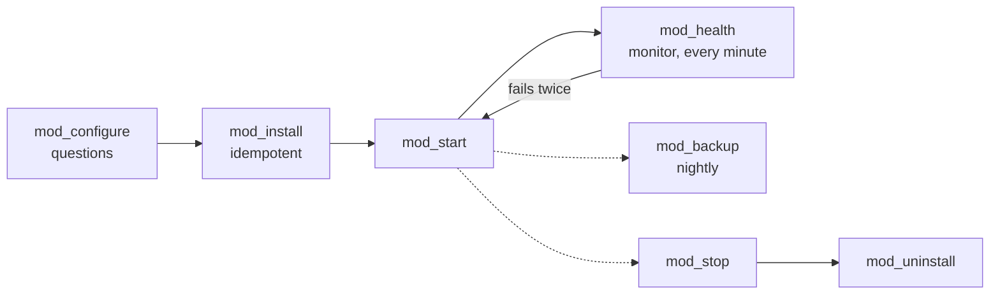

# Writing a module

This guide is for contributors who want to add a service to resurrect. It explains the module contract, walks through a complete working example, lists the helpers modules use, and describes the rules that keep services reliable on Android. You should be comfortable with Bash.

## Contents

- [Prerequisites](#prerequisites)
- [How modules work](#how-modules-work)
- [A complete example](#a-complete-example)
- [Add the module step by step](#add-the-module-step-by-step)
- [Contract reference](#contract-reference)
- [Helpers](#helpers)
- [Reliability rules](#reliability-rules)
- [Troubleshooting](#troubleshooting)

## Prerequisites

- A development checkout with the privacy hooks enabled ([CONTRIBUTING.md](../CONTRIBUTING.md#development-setup)).
- `bats`, `python3` and `shellcheck` to run the tests ([testing.md](testing.md)).

## How modules work

A module is one file, `modules/<name>.sh`, sourced by `rez`. It sets metadata variables and defines `mod_*` functions. Setup, boot, cron, backups, monitoring and `rez status` discover modules through this contract, so adding a module never means editing those parts of the core. The only other change is adding the name to `REZ_MODULE_ORDER` in `lib/modules.sh`.



Actions that change state (`configure`, `install`, `start`, `stop`, `uninstall`, `backup`, `cli`) run in their own Bash process with `set -Eeuo pipefail`, so a failing command always stops the action. Read-only actions (`status`, `health`, `info`, `cron`, `doctor`, `restore_check`) run in a subshell, which keeps `rez status` fast on old devices.

## A complete example

This module serves one folder over HTTP with Python's built-in web server. It uses no downloads, so you can run it anywhere Python is installed. It implements every common hook.

```bash
# shellcheck shell=bash
# staticweb: serve one folder over HTTP with Python's built-in web server.
# A minimal, complete example of the module contract (docs/writing-a-module.md).

MOD_NAME=staticweb
MOD_DESC="Static web server for one folder (example)"
MOD_DEPENDS="base"
MOD_PORTS="8090"
MOD_RAM_EST_MB=15
MOD_DISK_EST_MB=1
MOD_TESTED="no (example module)"

SW_DIR=$REZ_DATA_DIR/staticweb

_port() { cfg_get staticweb.port 8090; }
_site() { local p; p=$(cfg_get staticweb.path "$HOME/public"); echo "${p/#\~/$HOME}"; }

# Questions. Answers go in the config file, so a rerun or --config skips them.
mod_configure() {
  local path
  path=$(cfg_get staticweb.path "")
  [[ -n "$path" ]] || path=$(ui_input "Static web" "Folder to serve" "$HOME/public")
  cfg_set staticweb.path "$path"
}

# Idempotent: running it twice must be safe.
mod_install() {
  ensure_dir 700 "$SW_DIR"
  ensure_dir 755 "$(_site)"
  if [[ ! -e "$(_site)/index.html" ]]; then
    echo '<h1>It works</h1>' | atomic_write "$(_site)/index.html" 644
  fi
}

# The process is "python3 -m http.server ...": argv[2] is http.server.
mod_start() {
  svc_start staticweb http.server "" -- nice -n 10 "$PREFIX/bin/python3" -m http.server \
    "$(_port)" --bind "$(service_bind)" --directory "$(_site)"
}
mod_stop() { svc_stop staticweb http.server; }
mod_status() { svc_status_line staticweb http.server "" "port $(_port), serving $(_site)"; }

mod_health() {
  svc_running staticweb http.server || { echo "not running"; return 1; }
  port_open 127.0.0.1 "$(_port)" || { echo "port $(_port) closed"; return 1; }
}

# A small site, so the whole folder goes in the backup. Modules with large
# data back up their settings only.
mod_backup() { mkdir -p "$1"; cp -a "$(_site)/." "$1/site"; }
mod_restore_check() { [[ -f "$1/site/index.html" ]] || { echo "index.html missing"; return 1; }; }

mod_uninstall() {
  [[ "${REZ_PURGE:-0}" == 1 ]] && run_cmd rm -rf "$SW_DIR"
  info "files in $(_site) were left in place"
}

mod_info() { printf 'Web:        http://%s:%s\n' "$(device_host)" "$(_port)"; }

mod_cli() {
  case "${1:-}" in
    url) printf 'http://%s:%s\n' "$(device_host)" "$(_port)" ;;
    *) die "usage: rez staticweb url" ;;
  esac
}
```

## Add the module step by step

1. **Create the file.** Save the module as `modules/staticweb.sh`. `MOD_NAME` must equal the file name.
2. **Register it.** Add the name to `REZ_MODULE_ORDER` in `lib/modules.sh`. The order is the start order, so put it after its dependencies.
3. **Run the contract tests:**

   ```bash
   bats tests/bats/modules.bats
   ```

   All tests pass, including `module contract: metadata and required functions`.
4. **Try it without changing anything:**

   ```bash
   REZ_ALLOW_NON_TERMUX=1 HOME=$(mktemp -d) bin/rez --dry-run --yes setup --modules base,staticweb
   ```

5. **Run it for real in Termux:**

   ```bash
   rez install staticweb
   rez status
   rez staticweb url
   ```

   `rez status` shows a line like:

   ```text
   staticweb      running  pid 12345   port 8090, serving /data/data/com.termux/files/home/public
   ```

6. **Test it in the Termux container** if it can run there: add checks to `tests/termux-docker/integration.sh`.
7. **Be honest about testing.** Fill in `MOD_TESTED` and the table in [testing.md](testing.md).
8. **Document it.** Add the module to the features table in the [README](../README.md#features).

## Contract reference

### Metadata

| Variable | Default | Meaning |
|---|---|---|
| `MOD_NAME` | (required) | Must equal the file name |
| `MOD_DESC` | (required) | One line, shown in menus and `rez modules` |
| `MOD_ROOT` | `no` | `no`, `optional` (root unlocks extras) or `required` |
| `MOD_DEPENDS` | none | Space-separated modules installed first |
| `MOD_PORTS` | none | Shown in the setup plan |
| `MOD_ARCHES` | `arm64 armv7 amd64 386` | Architectures with a build |
| `MOD_MIN_RAM_MB` | `0` | Minimum MemTotal; `0` means no limit |
| `MOD_NEEDS_EXTERNAL` | `0` | `1` if the module needs an SD card or external storage |
| `MOD_RAM_EST_MB` | `0` | RAM estimate for the setup plan |
| `MOD_DISK_EST_MB` | `0` | Disk estimate for the setup plan |
| `MOD_SERVICE` | `1` | `0` for modules without a long-running process |
| `MOD_TESTED` | `no` | What was tested where, honestly |

A module that doesn't fit the device (root, RAM, storage or architecture) is shown with the reason in setup and `rez modules`, and can't be selected.

### Functions

| Function | Required | Called by | Purpose |
|---|---|---|---|
| `mod_install` | Always | `rez setup`, `rez install` | Install or update. Must be safe to run twice |
| `mod_status` | Always | `rez status` | Print one line; return non-zero if not running |
| `mod_start` | Services | Boot, `rez start`, `monitor` | Start if not running |
| `mod_stop` | Services | `rez stop`, `rez uninstall` | Stop |
| `mod_health` | Services | `monitor`, `rez doctor`, `rez health` | Return 0 if healthy; otherwise print one short reason |
| `mod_configure` | No | Setup, before installing | Ask questions and store answers with `cfg_set` |
| `mod_uninstall` | No | `rez uninstall` | Remove binaries. Delete data only when `REZ_PURGE=1` |
| `mod_backup DIR` | No | `rez backup run` | Copy what matters into `DIR` |
| `mod_restore_check DIR` | No | `rez backup verify` | Check a restored copy in `DIR`; may print a short summary |
| `mod_cron` | No | `rez cron sync`, after installs | Print crontab lines |
| `mod_info` | No | End of setup | Print how to reach the service |
| `mod_cli ARGS` | No | `rez <module> <action>` | Extra commands |
| `mod_doctor` | No | `rez doctor` | Print extra `PASS`/`FAIL` lines |

`tests/bats/modules.bats` enforces the required functions.

## Helpers

Modules can use every function in `lib/`. These are the ones you need most:

| Helper | Use |
|---|---|
| `svc_start NAME EXE ARGS_REGEX -- CMD...` | Start a service detached, unless it already runs. Logs to `~/.local/state/resurrect/logs/NAME.log` |
| `svc_stop NAME EXE [ARGS_REGEX]` | Stop it, and its supervisor if any |
| `svc_running NAME EXE [ARGS_REGEX]` | Is it running? |
| `svc_status_line NAME EXE ARGS_REGEX EXTRA` | The standard `rez status` line, including a warning when several copies run |
| `cfg_get KEY [DEFAULT]` / `cfg_set KEY VALUE` | Read and write `~/.config/resurrect/resurrect.conf`. Keys look like `module.setting` |
| `secret_ensure NAME [LENGTH]` | Print a secret, generating it on first use (mode 600) |
| `secret_get` / `secret_set` / `secret_del` | Read, write and delete secrets |
| `fetch_pinned TOOL` | Download the pinned release for this architecture, verified against `lib/versions.sh`; prints the path |
| `fetch_verified URL SHA256 DEST` | Download one file and verify it. Refuses an empty checksum |
| `ensure_dir MODE DIR...` | Create directories with a mode |
| `atomic_write FILE [MODE]` | Write stdin to a file atomically |
| `run_cmd CMD...` | Run a command, or only print it with `--dry-run` |
| `as_root CMD` | Run a command with `su`. Dies if root is not available |
| `service_bind` | The address to listen on: `127.0.0.1` with built-in Tailscale, `0.0.0.0` otherwise |
| `device_host` | How other devices reach this one, for URLs shown to the user |
| `port_open HOST PORT` | Is a TCP port accepting connections? |
| `mem_available_mb` | MemAvailable in MB |
| `ui_input`, `ui_password`, `ui_yesno`, `ui_menu`, `ui_msg` | Prompts that work in dialog, plain and non-interactive modes |
| `proot_exec CMD...` / `PROOT_CMD` | Run a command inside proot Debian |
| `notify_send TITLE MESSAGE [PRIORITY] [TAGS]` | Send an ntfy alert. Never fails the caller |
| `rez_cmd` | The full-path `rez` command for cron lines |
| `info`, `ok`, `warn`, `err`, `die` | Messages to the user |

## Reliability rules

These rules come from outages on a real device. The core enforces most of them when you use the helpers.

**Processes.** Always use `svc_start`, `svc_stop` and `svc_running` with an executable name and, if needed, an argument regex. They match `/proc/<pid>/cmdline`, ignore stale pidfiles, skip commands that only mention the service (`ssh`, `grep`, `bash -c "..."`), and never start a second copy. Don't use `pgrep -f`, or `kill -0` on a pidfile.

- `EXE` is the basename of one of the first three argv entries. That is why `python3 -m http.server` matches `http.server`, and a binary started through proot still matches its own name.
- `SVC_SUPERVISE=1` wraps the command in `lib/supervise.sh`: restart with backoff from 5 seconds up to 5 minutes, and an ntfy alert on the first crash and every fifth. Use it for anything that must not stay down.
- `SVC_ENV=("KEY=value")` passes environment variables. Put secrets there or in files, never on the command line, because `/proc/<pid>/cmdline` is readable.
- Prefix low-priority work with `nice -n 10`.

**Root.** Check `REZ_HAS_ROOT` (never call `su` to find out) and run root commands with `as_root`. Root-only modules set `MOD_ROOT=required`. Never reboot, never flash.

**Downloads.** Only through `fetch_pinned` or `fetch_verified`, with a checksum in `lib/versions.sh`. No checksum, no download.

**Config and secrets.** Store answers with `cfg_set`. Generate passwords with `secret_ensure`. Never print a secret except in an explicit command such as `show-password`.

**Dry run.** Wrap commands that change the system in `run_cmd`, and write files with `atomic_write`, so `rez --dry-run` shows what would happen instead of doing it.

**Binding.** Listen on `$(service_bind)`.

**Android quirks.**

- Go and musl binaries can't find CA certificates on Android. Pass `SVC_ENV=("${TLS_ENV[@]}")`.
- Ports below 1024 need root.
- At boot, `termux-exec` isn't loaded. Use full paths such as `$PREFIX/bin/python3`, not `#!/usr/bin/env`.
- Use `mem_available_mb`, never `free`.
- If a program needs a normal Linux filesystem, run it in Debian with `proot_exec` or `PROOT_CMD`.

**Health output.** When `mod_health` fails, print one short line saying why. The monitor puts it in the alert.

## Troubleshooting

| Symptom | Cause | Fix |
|---|---|---|
| `unknown module: <name>` | The file is missing or misnamed | The file must be `modules/<name>.sh` |
| `modules/<name>.sh sets MOD_NAME=...` | `MOD_NAME` doesn't match the file name | Make them equal |
| `every module in the order list exists` fails | The name is not in `REZ_MODULE_ORDER` | Add it in `lib/modules.sh` |
| `<name> did not stay up; last log lines:` | The process exited, or `EXE` doesn't match its argv | Read the log lines, and check `tr '\0' ' ' < /proc/<pid>/cmdline` while it runs |
| `rez status` says stopped while it runs | `EXE` or `ARGS_REGEX` doesn't match | Same check as above |
| An install error is ignored | A command's failure is swallowed by `\|\| true` or a pipeline | Remove the `\|\| true`; actions already run with `set -e` |
