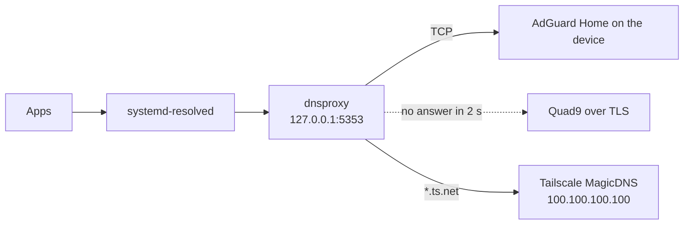

# Computer-side extras

These scripts run on the computer you manage your resurrect device from, not on the device itself. One copies backups off the device every day; the other lets the computer use the device's AdGuard Home with an automatic fallback, so the device can never take your internet down.

## Contents

- [Prerequisites](#prerequisites)
- [Pull backups off the device](#pull-backups-off-the-device)
- [Use AdGuard Home without risking your internet](#use-adguard-home-without-risking-your-internet)
- [Troubleshooting](#troubleshooting)

## Prerequisites

- SSH access to the device with a key. resurrect's `base` module sets up sshd on port 8022 with key-only login.
- For backups: `rsync` and `sha256sum` on the computer.
- For DNS on Linux: systemd-resolved and [dnsproxy](https://github.com/AdguardTeam/dnsproxy) (Arch: `pacman -S dnsproxy`).

## Pull backups off the device

A backup that only lives on the device dies with it. `pull-backups.sh` copies the nightly archives to your computer over SSH.

### 1. Add an SSH alias

Add the device to `~/.ssh/config` on your computer:

```text
Host phone
    HostName <device's Tailscale name or IP>
    Port 8022
    User <Termux user: run whoami in Termux>
    IdentityFile ~/.ssh/id_ed25519
```

Check it with `ssh phone true`.

### 2. Run a pull

```bash
./pull-backups.sh phone
```

The first argument is any SSH destination; an alias is easiest. Copies go to `~/resurrect-backups/phone` unless you pass a second argument with another folder.

How it behaves:

- **It never deletes a copy because the device lost it.** It never uses `rsync --delete`. It prunes old copies itself, by date, keeping the newest 14.
- **Every archive is verified** against the checksum the device wrote. A mismatch fails the run.
- **An unreachable device is not an error.** If you're away or the device is rebooting, the script logs that and exits successfully.
- **The device is told about good pulls.** After a successful pull the script runs `rez backup mark-pulled` on the device. With `backup.expect_pull=yes`, the device alerts you when no pull has happened for 3 days.
- **The copies stay private.** The destination folder is set to mode 700, because archives contain password hashes and keys.

| Environment variable | Default | Meaning |
|---|---|---|
| `REZ_KEEP` | `14` | Copies to keep on the computer |
| `REZ_SSH_PORT` | `8022` | SSH port, if not set in `~/.ssh/config` |
| `REZ_REMOTE_DIR` | `resurrect-backups` | Backup folder on the device, relative to Termux's home |

### 3. Run it daily

**Linux, with a systemd user timer:**

```bash
install -Dm755 pull-backups.sh ~/.local/bin/resurrect-pull-backups
install -Dm644 systemd/resurrect-pull-backups@.service systemd/resurrect-pull-backups@.timer -t ~/.config/systemd/user/
systemctl --user daemon-reload
systemctl --user enable --now resurrect-pull-backups@phone.timer
```

`phone` after the `@` is your SSH alias. The timer runs daily at 09:00, after the device's 03:30 backup. A run missed while the computer was off happens at the next start. To read the logs:

```bash
journalctl --user -u resurrect-pull-backups@phone
```

**macOS, or anything with cron:**

```text
0 9 * * * /path/to/pull-backups.sh phone >> ~/resurrect-pull.log 2>&1
```

## Use AdGuard Home without risking your internet

> [!CAUTION]
> Never make the device the only DNS server for your computers. If it reboots, crashes, runs out of battery or drops off Wi-Fi, every computer that depends on it loses the internet. Listing a second DNS server in your system settings is not a reliable fallback: some systems query both at once and leak around the blocker, and some keep using the dead one for a while.

The setup in `dns-fallback/` runs a small local forwarder, dnsproxy, on the computer. Every lookup asks the device first and falls back to a public resolver after 2 seconds:



DNS to the device uses TCP on purpose: inbound UDP forwarding has crashed userspace Tailscale on Android. Names under `ts.net` go to Tailscale's MagicDNS, so your tailnet names keep working.

### Linux with systemd-resolved

1. Install it, using port 5335 when AdGuard Home runs without root and 53 in root mode:

   ```bash
   sudo bash dns-fallback/setup-linux.sh --phone <device address> --port 5335
   ```

   | Option | Meaning |
   |---|---|
   | `--phone ADDRESS` | The device's Tailscale IP or LAN IP (required) |
   | `--port PORT` | AdGuard Home's DNS port: `5335` (default) or `53` |
   | `--fallback URL` | Fallback resolver (default `tls://dns.quad9.net`) |
   | `--networkmanager` | Stop NetworkManager from handing each Wi-Fi network's DNS servers to systemd-resolved, where they would race AdGuard Home |
   | `--tailscale` | Stop Tailscale from overriding DNS on this computer. `*.ts.net` names still resolve |

2. Check that names resolve:

   ```bash
   resolvectl query example.com
   ```

3. Prove the fallback works. Stop AdGuard Home on the device, query again, then start it:

   ```bash
   ssh phone rez stop adguard
   resolvectl query example.com     # must still resolve, through the fallback
   ssh phone rez start adguard
   ```

To remove everything and return to your previous DNS setup:

```bash
sudo bash dns-fallback/undo-linux.sh
```

### macOS and Windows

Install dnsproxy (on macOS with Homebrew: `brew install dnsproxy`; on Windows, a [release binary](https://github.com/AdguardTeam/dnsproxy/releases)) and run it with the same options as the Linux setup. Port 53 needs administrator rights:

```bash
sudo dnsproxy -l 127.0.0.1 -p 53 -u tcp://<device address>:5335 -u "[/ts.net/]100.100.100.100" \
  -f tls://dns.quad9.net -b 9.9.9.9:53 --timeout=2s --cache --cache-optimistic
```

Then set the system DNS server to `127.0.0.1`. To undo, stop dnsproxy and set DNS back to automatic.

> [!NOTE]
> The macOS and Windows commands have not been tested. The Linux scripts have been used on the original setup this project grew out of.

### Phones, tablets and whole networks

Android's Private DNS and iOS DNS profiles have no fallback, so point them at the device only if you accept that they lose DNS when it is down. For a whole network, set the device as the primary DNS server in your router and a public resolver as the secondary, knowing that some ads will get through the secondary.

### If names stop resolving

1. On the affected computer: `sudo bash dns-fallback/undo-linux.sh`, or set DNS back to automatic.
2. If you made the device a Tailscale global nameserver: in the Tailscale admin console, DNS page, turn off **Override local DNS** or remove the device's address. If the computer you're on has no DNS, use a phone on mobile data with Tailscale switched off.
3. On a single device right now: `tailscale set --accept-dns=false` (Android app: **Settings > Use Tailscale DNS** off).
4. Fix AdGuard Home on the device (`rez status`, `rez logs adguard`, `rez adguard test`), then turn things back on.

The full guide, including an outage case study, is in [docs/dns-and-adguard.md](../../docs/dns-and-adguard.md).

## Troubleshooting

| Symptom | Cause | Fix |
|---|---|---|
| A pull logs that the device is unreachable | The device is off, rebooting or not on your tailnet | Expected when away. Check with `ssh phone true` |
| `MISMATCH` in the pull output | An archive was damaged in transfer or on the device | Run the pull again. If it repeats, run `rez backup verify` on the device |
| The device alerts `backups have not left the phone for 3 days` | The pull job isn't running | Check `systemctl --user list-timers` and the journal |
| `install dnsproxy first` | dnsproxy is missing | Install it from your distribution or the dnsproxy releases |
| `systemd-resolved is not running` | The computer uses another resolver | Use the macOS and Windows method, pointing your resolver at dnsproxy |
| Names resolve slowly | The device is down, so every lookup waits for the fallback | Fix the device, or run `undo-linux.sh` until you can |
